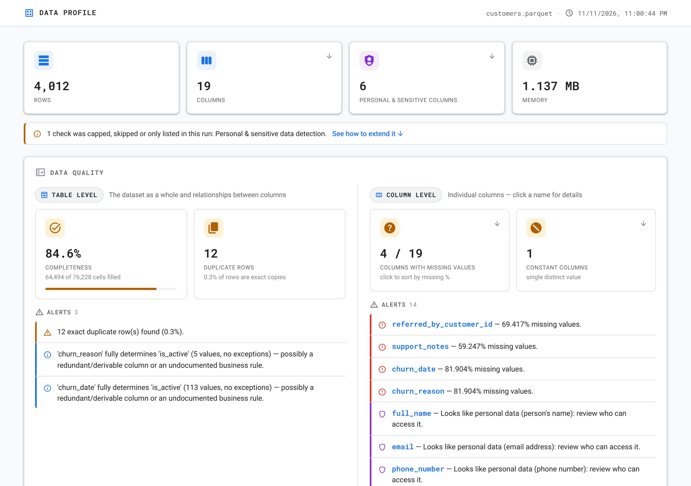
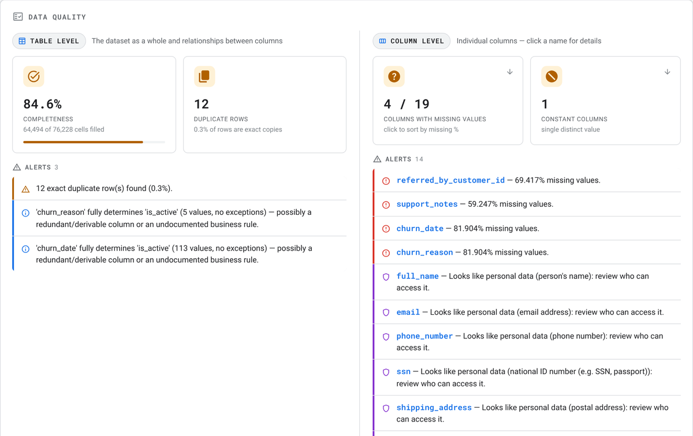
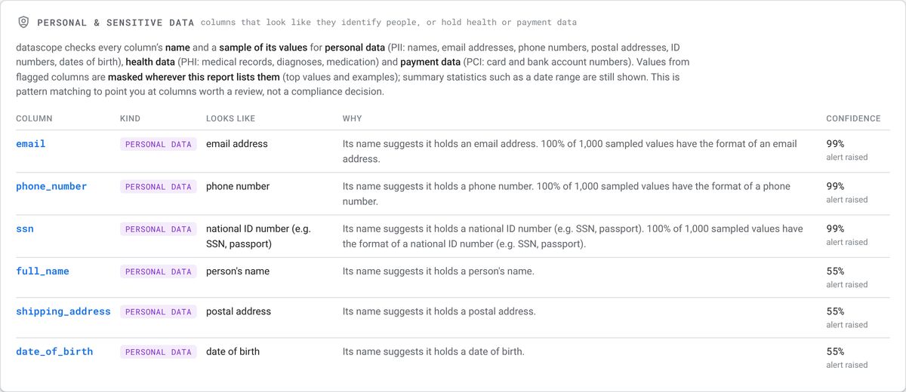
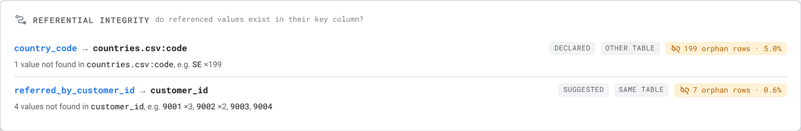
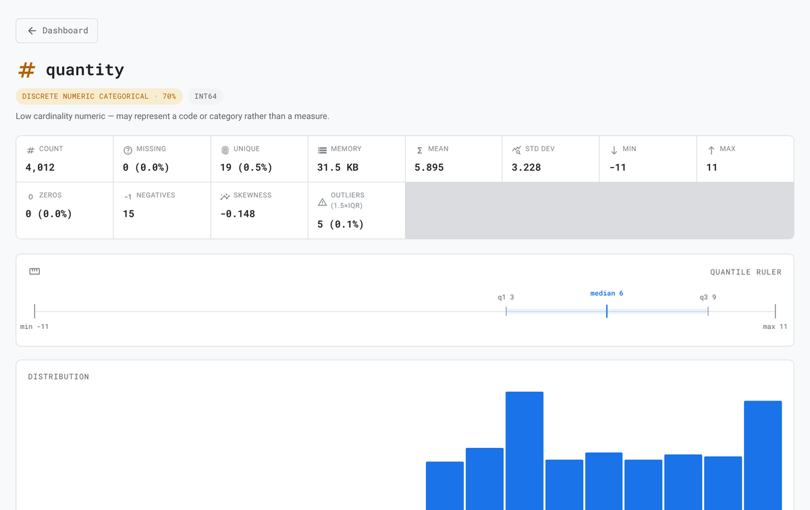
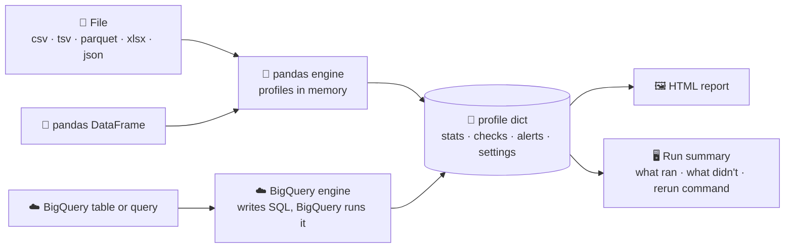

<div align="center">

# 🔭 datascope

### Profile any dataset into one beautiful, self-contained HTML report

**A pandas DataFrame, a file, or a BigQuery table in → an interactive data-quality dashboard out.**
<br>No server, no JavaScript framework, no build step: just one `.html` file you can open, email or host.

[](https://github.com/ManuelCorsetti/datascope/actions/workflows/ci.yml)


[🚀 Quick start](#-quick-start) •
[🖼️ The report](docs/report-tour.md) •
[🔎 Checks](docs/checks.md) •
[☁️ BigQuery](docs/bigquery.md) •
[⚙️ Settings](docs/settings.md) •
[📚 All docs](docs/README.md)

<br>



</div>

---

## ✨ Why datascope

<table>
<tr>
<td width="33%" valign="top">

### 📄 One file, zero setup
The report is a single, self-contained `.html` file. Open it in any browser, attach it to an email, drop it on a wiki. Nothing to install for the people reading it.

</td>
<td width="33%" valign="top">

### 🩺 Data quality, kept honest
Completeness, duplicates, constant columns and alerts, split into **table-level** and **column-level** checks, never blended into one opaque score.

</td>
<td width="33%" valign="top">

### 🔐 Personal data, flagged and masked
Finds columns that hold **PII**, health or payment data from names *and* values, explains why, and masks the values the report lists.

</td>
</tr>
<tr>
<td valign="top">

### 🔗 Relationships between columns
**Referential integrity** (do the IDs exist?), **column relationship dependencies** (`zip → state`), correlations and primary-key candidates.

</td>
<td valign="top">

### ☁️ BigQuery, in the warehouse
Profile a table or query **inside BigQuery**: only aggregates come back. Estimate the cost first, or profile a 1% sample and project the full run.

</td>
<td valign="top">

### 🔁 Repeatable by design
Every threshold is a documented setting. Every run tells you what it checked, what it **didn't**, and prints the command to reproduce or extend it.

</td>
</tr>
</table>

---

## 🚀 Quick start

**1. Install**

```bash
pip install -e .                 # core: pandas + numpy
pip install -e ".[bigquery]"     # + profile BigQuery tables
```

**2. Profile something.** Pick whichever fits:

```bash
# 💻 From the command line
datascope sales.csv -o sales.html --open
```

```python
# 🐍 From Python: a file or a DataFrame
from datascope import profile

profile("sales.csv", output_html="sales.html")
profile(df, output_html="sales.html", source_name="sales")
```

```bash
# ☁️ Inside BigQuery: only aggregates leave the warehouse
datascope --bq-table my-project.sales.orders -o orders.html
```

**3. Or try it on built-in demo data** (a messy customer table with personal data, duplicates, dangling IDs and a few planted bugs):

```bash
python example.py        # writes example_report.html
```

> [!TIP]
> New here? The **[Getting started guide](docs/getting-started.md)** walks through installing, your first report and what to look at first, in about five minutes.

---

## 🖼️ What you get

<table>
<tr>
<td width="55%"><a href="docs/report-tour.md#-data-quality"></a></td>
<td valign="top">

### 🩺 Data quality, at two levels
**Table level:** completeness and duplicate rows.<br>
**Column level:** missing values, constant columns.<br>
Each side has its own alerts, most severe first. Click a column name to jump to it.

<sub>[Read more →](docs/report-tour.md#-data-quality)</sub>

</td>
</tr>
<tr>
<td valign="top">

### 🔐 Personal & sensitive data
Which columns look like they hold **PII**, health or payment data, *why* (in plain words), and how confident datascope is. Listed values are masked: `j***@***.com`.

<sub>[Read more →](docs/report-tour.md#-personal--sensitive-data)</sub>

</td>
<td width="55%"><a href="docs/report-tour.md#-personal--sensitive-data"></a></td>
</tr>
<tr>
<td width="55%"><a href="docs/report-tour.md#-referential-integrity"></a></td>
<td valign="top">

### 🔗 Referential integrity
Do the IDs exist? Declare checks with `--reference`, or let datascope spot them from column names. You get orphan rows, the missing values and examples.

<sub>[Read more →](docs/report-tour.md#-referential-integrity)</sub>

</td>
</tr>
<tr>
<td valign="top">

### 🔬 Every column, in detail
Statistics, a quantile ruler, the distribution, top values, suggested **quality rules**, and a ready-to-paste **dbt** test block.

<sub>[Read more →](docs/report-tour.md#-column-detail)</sub>

</td>
<td width="55%"><a href="docs/report-tour.md#-column-detail"></a></td>
</tr>
</table>

<p align="center">👉 <b><a href="docs/report-tour.md">Take the full tour of the report</a></b></p>

---

## 🧭 How it works



Both engines produce the **same profile dict**, so the report, the alerts and the run summary work identically. The BigQuery engine does less (no histograms or duplicate-row counts, for example) because each extra check would mean another pass over your warehouse. The **[checks guide](docs/checks.md#-what-each-engine-supports)** has the full comparison.

---

## 📚 Documentation

| | Guide | What's inside |
|---|---|---|
| 🚀 | **[Getting started](docs/getting-started.md)** | Install, your first report, the demo dataset, what to look at first |
| 🖼️ | **[A tour of the report](docs/report-tour.md)** | Every panel, with screenshots, and how to read it |
| 🔎 | **[The checks](docs/checks.md)** | What each check does, how it decides, which engine supports what |
| ☁️ | **[BigQuery](docs/bigquery.md)** | Setup, cost estimates, sampling, slot usage, things to know |
| ⚙️ | **[Settings & repeatable runs](docs/settings.md)** | Every setting with its default, the run summary, fixed heuristics |
| 💻 | **[Command line reference](docs/cli.md)** | Every flag, grouped, plus a cookbook of common runs |
| 🐍 | **[Python API](docs/python-api.md)** | Functions, classes, and the structure of the profile dict |

---

## ❓ FAQ

<details>
<summary><b>Does my data leave my machine?</b></summary>
<br>

No. The pandas engine works entirely in memory on your machine. The BigQuery engine runs SQL **inside BigQuery** and only brings back aggregates, never rows. The report file contains statistics plus a handful of example values (top values, examples of broken references). Values from columns flagged as personal data are masked wherever the report lists them. The report makes no network requests at all: its fonts and icons are built into the file, and a Content-Security-Policy in it blocks any connection.

</details>

<details>
<summary><b>Is the report safe to share?</b></summary>
<br>

It's designed to be: no raw rows, and listed values from personal-data columns are masked (e.g. `j***@***.com`). A flagged column's minimum, maximum, quartiles and earliest / latest date are left out too, since each is a real value; averages and counts stay. The caveat: detection is pattern matching, so a column it misses isn't masked. Skim the [Personal & sensitive data](docs/report-tour.md#-personal--sensitive-data) panel before sharing widely.

</details>

<details>
<summary><b>Why isn't there a single "quality score"?</b></summary>
<br>

A blended 0–100 score hides which dimension is bad: a table can score 90 with a broken key. datascope shows each check separately, split into [table-level and column-level](docs/report-tour.md#-data-quality) results, so every number points at something you can fix.

</details>

<details>
<summary><b>How much will profiling a BigQuery table cost?</b></summary>
<br>

Run `--estimate` first: it dry-runs every query (free) and prints the bytes and cost **per section**. If your organisation pays for slots, try `--sample`, which profiles 1% of the table and projects the full run's slot time. See [BigQuery costs](docs/bigquery.md#-what-it-costs).

</details>

<details>
<summary><b>Some checks say "partial" or "skipped". What do I do?</b></summary>
<br>

That's the run summary telling you a limit kicked in or a check was turned off. It prints the exact flag that would extend each one, and a ready-made command that extends them all. See [the run summary](docs/settings.md#-the-run-summary).

</details>

<details>
<summary><b>Which file formats are supported?</b></summary>
<br>

`.csv`, `.tsv`, `.json`, `.parquet` / `.pq` (needs `pip install pyarrow`) and `.xlsx` (needs `pip install -e ".[excel]"`). See [Getting started](docs/getting-started.md#-supported-inputs).

</details>

---

## 🛠️ Development

```bash
pip install -e ".[dev]"     # pytest, plus DuckDB + sqlglot to run the BigQuery SQL locally
pytest                      # the whole suite, including the BigQuery engine (no GCP needed)
python example.py           # regenerate the demo report
```

<details>
<summary><b>🗂️ Project layout</b></summary>

```
src/datascope/
├── core.py           DataProfiler: orchestration, correlations, keys, alerts
├── bigquery.py       BigQuery engine: generates the SQL, maps results to the profile dict
├── stats.py          numeric / text / date / boolean statistics and histograms
├── semantic.py       semantic type inference (identifier, categorical, free text, ...)
├── pii.py            personal & sensitive data detection, value masking
├── quality.py        quality-rule suggestions and dbt test snippets
├── relationships.py  column relationship dependencies (A determines B)
├── referential.py    referential-integrity checks (declared and suggested)
├── settings.py       every tunable threshold: defaults, validation, CLI flags, help
├── run_summary.py    what each run checked or left out, reproduce/extend commands
├── html_report.py    renders the profile dict into the HTML report
└── cli.py            the `datascope` command (flags generated from settings.py)
tests/                pytest suite; duckdb_bigquery.py runs the generated BigQuery SQL on DuckDB
docs/                 the documentation you're reading
example.py            synthetic messy dataset + runnable demo
```

</details>

The settings table in [docs/settings.md](docs/settings.md#-all-settings) is generated from `settings.py`, and a test fails if it goes stale. Regenerate it with `python -c "from datascope.settings import settings_markdown; print(settings_markdown())"`.

<div align="center">
<br>
<sub>Made for people who'd rather understand their data than guess at it. 🔭</sub>
</div>
