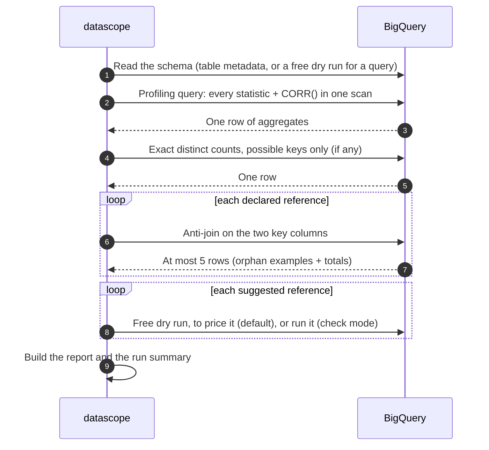

# ☁️ BigQuery

> Profile a table or a query **inside BigQuery**: datascope writes the SQL, BigQuery runs it, and only aggregates come back. No rows are downloaded.

[📚 Docs home](README.md) • [🚀 Getting started](getting-started.md) • [🖼️ Report tour](report-tour.md) • [🔎 Checks](checks.md) • [⚙️ Settings](settings.md) • [💻 CLI](cli.md) • [🐍 Python API](python-api.md)

---

**On this page**

| Get going | Control cost | Reference |
|---|---|---|
| [🔧 Setup](#-setup) | [💰 What it costs](#-what-it-costs) | [🧠 What runs in BigQuery](#-what-runs-in-bigquery) |
| [🏁 Profile a table or query](#-profile-a-table-or-a-query) | [🧪 Profile a sample first](#-profile-a-sample-first) | [🔗 Referential integrity](#-referential-integrity-on-bigquery) |
| [🚕 Worked example: NYC taxis](#-worked-example-nyc-taxi-trips) | [🔢 Distinct counts and slot time](#-distinct-counts-and-slot-time) | [📟 Progress and cancelling](#-progress-job-ids-and-cancelling) |
| | [📈 Correlations](#-correlations-on-bigquery) | [🚧 Things to know](#-things-to-know) |

---

## 🔧 Setup

**1. Install the extra**

```bash
pip install -e ".[bigquery]"
```

**2. Sign in** (once per machine). datascope uses your default Google credentials:

```bash
gcloud auth application-default login
```

**3. Permissions.** You need to be able to **run jobs** in the project that pays for the queries (typically the *BigQuery Job User* role), and to **read** the data you profile (typically *BigQuery Data Viewer*).

> [!TIP]
> Pass `--bq-project` (Python: `project=`) to choose which project runs and pays for the queries; it can differ from the project holding the data. Add `--bq-location` (e.g. `US`, `EU`) to match the data's location.

---

## 🏁 Profile a table or a query

<table>
<tr><th>💻 Command line</th><th>🐍 Python</th></tr>
<tr>
<td>

```bash
# a whole table
datascope --bq-table my-project.sales.orders \
  -o orders.html

# only some columns
datascope --bq-table my-project.sales.orders \
  --columns order_id,amount,status

# the result of a query
datascope --bq-query-file recent_orders.sql \
  -o recent.html
```

</td>
<td>

```python
from datascope import profile_bigquery

# a whole table
profile_bigquery("my-project.sales.orders",
                 output_html="orders.html")

# only some columns
profile_bigquery("my-project.sales.orders",
                 columns=["order_id", "amount", "status"])

# the result of a query
profile_bigquery(query="""
  SELECT o.*, c.country
  FROM `my-project.sales.orders` o
  JOIN `my-project.sales.customers` c USING (customer_id)
  WHERE o.created_at >= '2026-01-01'
""", output_html="recent.html")
```

</td>
</tr>
</table>

> [!NOTE]
> In Bash and Git Bash, put SQL in **single quotes**: ``--bq-query 'SELECT * FROM `project.dataset.table`'``. Inside double quotes, the backticks around table names would run as a shell command. For anything longer, `--bq-query-file` is easier.

The result is the same report and the same [profile dict](python-api.md#-the-profile-dict) as the pandas engine. The SQL that ran is in `result["meta"]["sql"]`.

---

## 💰 What it costs

BigQuery has two pricing models, and they charge for different things:

| | 💵 On-demand | 🎰 Capacity (slots) |
|---|---|---|
| **You pay for** | Bytes read by each query | Slot time (compute) |
| **Typical for** | Individuals, small teams | Larger organisations with a reservation |
| **What datascope's cost drivers are** | The columns profiled | Heavy operations such as exact distinct counts |
| **Predict it before running** | ✅ `--estimate` (a free dry run) | ⚠️ Not possible with a dry run: use `--sample` |
| **Measured after a run** | ✅ bytes processed | ✅ slot-seconds and bytes shuffled |

### 🧾 Estimate before you run

`--estimate` dry-runs every query (free, nothing is executed) and breaks the bytes down **by section**:

```bash
datascope --bq-table my-project.sales.orders --reference customer_id=my-project.sales.customers.id --estimate
```

```text
This profile will process 1.21 GB when run (about $0.0074 at $6.25/TiB on-demand). Nothing was run.

  profiling                                                    1.16 GB  $0.0071
  correlations                                                     0 B  $0.0000  Extra columns the first profiling query reads for CORR(); 0 when it already reads them all. --no-correlations removes it.
  reference customer_id -> my-project.sales.customers.id (declared)  48.20 MB  $0.0003
  exact distinct counts                                            0 B  $0.0000  Not priced: runs after profiling, re-reading only the columns that could be keys (no NULLs, nearly all unique), usually few or none.
  suggested references                                             0 B  $0.0000  Listed after profiling with their cost, not run (--suggested-references check runs them).

Dollar figures assume on-demand pricing (billed per byte processed). If your organisation pays for slots (capacity pricing), you are billed for slot time instead, which a dry run can't predict: each run reports its slot time.
```

<sub>Illustrative figures. The byte counts are upper bounds: clustered tables and cached results can come in lower. The dollar figure ignores the monthly free tier and regional prices.</sub>

### 🛡️ Put a ceiling on it

`--max-bytes-billed 10000000000` (Python: `maximum_bytes_billed=`) makes BigQuery **fail** a query rather than bill more than 10 GB for it.

### 📏 See what a run actually used

Every run reports, per query and in total, the **bytes processed**, the **slot time** and the **bytes shuffled**, as BigQuery's job details show them:

```text
BigQuery usage:
  profiling   2 queries: 150.21 MB processed, 412.3 slot-seconds, 310.40 MB shuffled
  references  1 query: 3.10 MB processed, 1.8 slot-seconds, 2.04 MB shuffled
```

<sub>Illustrative figures.</sub> The same numbers are in `result["meta"]["usage_by_section"]`. Comparing two runs with different settings, for example with and without `--no-correlations`, shows exactly what each option costs you.

---

## 🧪 Profile a sample first

`--sample` profiles a random **1%** of the table, capped at **1,000,000 rows**, then projects what the full run would use:

```bash
datascope --bq-table my-project.sales.orders --sample
datascope --bq-table my-project.sales.orders --sample-percent 5 --sample-max-rows 200000
```

It runs `SELECT * FROM <table> TABLESAMPLE SYSTEM (1 PERCENT) LIMIT 1000000`, which reads, and bills, only the sampled storage blocks. After the run:

```text
Sample: 8,412 rows (1% of my-project.sales.orders, which has 841,003 rows).
Profiling the whole table with the same settings would process about 1.21 GB (free dry run; what on-demand
pricing bills) and use roughly 420 slot-seconds (this run's slot time x 100.0, the table/sample row ratio;
a rough guide, large queries don't scale exactly).
```

<sub>Illustrative figures.</sub>

| | How it's worked out | How far to trust it |
|---|---|---|
| **Bytes** for a full run | A free dry run of the full-table queries | ✅ BigQuery's own figure, an upper bound |
| **Slot time** for a full run | The sample's measured slot time × (table rows ÷ sample rows) | ⚠️ A rough guide; big queries don't scale exactly linearly |

The report says it's a sample in the header, the [run strip](report-tour.md#-the-run-strip) and the run summary, and the reproduce command includes the sample flags.

> [!WARNING]
> - **Every figure in a sample report describes the sample.** Keys and references found in a sample may not hold for the whole table.
> - **Each query re-samples**, so the profiling, key and reference steps can see slightly different rows.
> - **Small tables**: `TABLESAMPLE` picks whole storage blocks, so a small table may come back whole or empty. datascope says so when that happens; raise `--sample-percent` if it's empty.

`--sample` also works with `--estimate` and `--print-sql`, which then describe the sample query. In Python: `profile_bigquery(table, sample_percent=1, sample_max_rows=1_000_000)`.

---

## 🔢 Distinct counts and slot time

An exact `COUNT(DISTINCT …)` makes BigQuery move (*shuffle*) a column's values between stages, once per column counted. On a ~150 MB table with 24 columns, that showed up as **5+ GB shuffled**: free on on-demand pricing, but **slot time** on capacity pricing.

So by default (`--distinct-counts keys`) datascope:

1. counts distinct values **approximately** for every column in the main query (`APPROX_COUNT_DISTINCT`, HyperLogLog++, typically within about 1%);
2. then counts **exactly**, in one small second query, only the columns that **could be keys**: no empty values, and an approximate unique share within 3 points of the bar a key must clear.

Primary-key and reference detection keep exact numbers, and the heavy shuffle is gone.

| `--distinct-counts` | Main query | Second query | Key detection | Slot cost |
|---|---|---|---|---|
| **`keys`** (default) | approximate | exact, possible keys only | ✅ exact | 🟢 low |
| `exact` | exact, every column | — | ✅ exact | 🔴 highest |
| `approx` | approximate | — | ❌ off | 🟢 lowest |

Columns counted approximately say so in their detail view.

---

## 📈 Correlations on BigQuery

Correlations are `CORR()` terms added to the **first** profiling query, for the first `--max-correlation-cols 30` numeric columns.

- For a table of up to `--max-columns-per-query 100` columns, that query **already reads every numeric column**, so correlations add **no bytes**. The `--estimate` line shows 0 B.
- They do add **computation** (n × (n − 1) / 2 pairs), so on slot pricing they cost some slot time. Compare a run with `--no-correlations` to see how much.
- On wider tables, the first query also has to read numeric columns from later batches, which `--estimate` prices.

---

## 🔗 Referential integrity on BigQuery

Each check is **one small anti-join query** that reads only the two key columns and returns at most `--ri-sample-orphans 5` rows. Nothing else is joined.

```bash
datascope --bq-table my-project.sales.orders \
  --reference customer_id=my-project.sales.customers.id \
  --reference parent_order_id=order_id
```

- **Declared** checks (`--reference`) always run. The parent is a column of the same table, or `project.dataset.table.column`.
- **Suggested** checks are **listed, not run**, by default: after the profiling query shows which columns really look like keys, each plausible pair is priced with a free dry run and shown with its cost. `--suggested-references check` runs them.

[How suggestions are chosen](checks.md#-suggested-checks).

---

## 🧠 What runs in BigQuery



- **One scan** does all the column statistics. Wide tables are split into queries of `--max-columns-per-query 100` columns, each column still read once.
- A **query** source is re-run for each of these queries.
- `--print-sql` prints the SQL without running anything.

---

## 📟 Progress, job IDs and cancelling

While it runs, datascope prints each step to stderr (hide it with `--quiet`):

```text
Reading the schema of my-project.sales.orders ...
Profiling 24 columns in 1 query.
Profiling query 1/1: running (job 8f2c1e4a-...) ...
Profiling query 1/1: done in 9.8s, 150.21 MB processed, 412.3 slot-seconds, 310.40 MB shuffled
Exact distinct counts for 2 possible key columns: running (job 3b7d...) ...
Exact distinct counts for 2 possible key columns: done in 2.1s, 12.80 MB processed, 6.0 slot-seconds, 4.10 MB shuffled
```

<sub>Illustrative figures.</sub>

- 🔎 The **job ID** lets you find the query in the console's job history.
- 🛑 **Ctrl+C cancels the running BigQuery job** before exiting. Otherwise BigQuery would keep running it, and billing it, after the program stopped.
- 💻 In **Git Bash** on Windows, Ctrl+C may not reach Python. PowerShell or cmd work reliably.

---

## 🚕 Worked example: NYC taxi trips

Google's public datasets are a good place to try things. Replace `my-project` with a project you can run jobs in.

```bash
# 1. What would it cost?
datascope --bq-table bigquery-public-data.new_york_taxi_trips.tlc_green_trips_2022 \
  --bq-project my-project --bq-location US --estimate

# 2. Profile it, with a 10 GB safety cap
datascope --bq-table bigquery-public-data.new_york_taxi_trips.tlc_green_trips_2022 \
  --bq-project my-project --bq-location US --max-bytes-billed 10000000000 -o green_taxi.html

# 3. Check that every pickup and drop-off zone exists in the zone lookup table
datascope --bq-table bigquery-public-data.new_york_taxi_trips.tlc_green_trips_2022 \
  --bq-project my-project --bq-location US \
  --reference pickup_location_id=bigquery-public-data.new_york_taxi_trips.taxi_zone_geom.zone_id \
  --reference dropoff_location_id=bigquery-public-data.new_york_taxi_trips.taxi_zone_geom.zone_id \
  -o green_taxi_ri.html

# 4. Same profile without correlations, to compare slot time
datascope --bq-table bigquery-public-data.new_york_taxi_trips.tlc_green_trips_2022 \
  --bq-project my-project --bq-location US --no-correlations -o green_taxi_no_corr.html
```

---

## 🚧 Things to know

- **Approximate figures**: quartiles use `APPROX_QUANTILES` and top values `APPROX_TOP_COUNT`, so both are approximate on large tables. So are distinct counts outside [possible keys](#-distinct-counts-and-slot-time).
- **Not available on BigQuery** (each would need extra passes): histograms, outliers, skewness and kurtosis, duplicate rows, identical columns, missing-value correlation, composite keys, column relationship dependencies, and spotting dates stored as text. [Full comparison](checks.md#-what-each-engine-supports).
- **Personal data** is detected from column **names only**.
- **Unrecognised column types are skipped, not guessed at**. The rest of the table is still profiled, and the skip is reported in the Alerts, on stderr, as an `UnsupportedColumnWarning`, and in `result["meta"]["skipped_columns"]`.
- **`ARRAY` columns** count empty arrays as missing. `ARRAY`, `STRUCT`, `JSON` and `GEOGRAPHY` columns only get null and distinct counts.
- **Query sources run more than once**: once per profiling batch, exact-count query and reference check.
