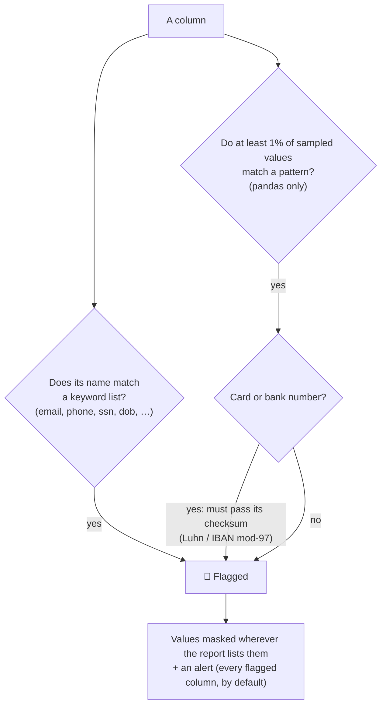
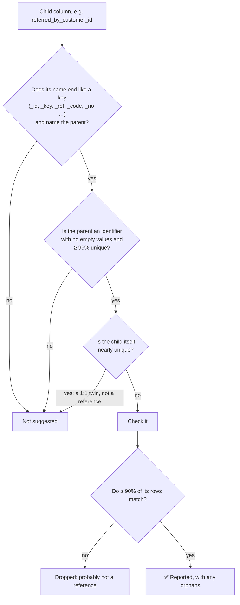

# 🔎 The checks

> What each check does, the exact rules behind it, and which engine supports what.

[📚 Docs home](README.md) • [🚀 Getting started](getting-started.md) • [🖼️ Report tour](report-tour.md) • [☁️ BigQuery](bigquery.md) • [⚙️ Settings](settings.md) • [💻 CLI](cli.md) • [🐍 Python API](python-api.md)

---

**On this page**

1. [🧮 What each engine supports](#-what-each-engine-supports)
2. [📐 Column statistics](#-column-statistics)
3. [🔖 Semantic types](#-semantic-types)
4. [🔐 Personal & sensitive data](#-personal--sensitive-data)
5. [🩺 Data quality & alerts](#-data-quality--alerts)
6. [📈 Correlations](#-correlations)
7. [🔑 Primary keys](#-primary-keys)
8. [🧩 Column relationship dependencies](#-column-relationship-dependencies)
9. [🔗 Referential integrity](#-referential-integrity)
10. [✅ Quality rules & dbt tests](#-quality-rules--dbt-tests)

> [!TIP]
> Every number in **`code`** below is a default. Almost all of them are [settings](settings.md#-all-settings) you can change per run. Those that aren't are listed under [fixed heuristics](settings.md#-fixed-heuristics).

---

## 🧮 What each engine supports

The **pandas** engine has the data in memory, so it can afford everything. The **BigQuery** engine runs SQL inside the warehouse, where every extra check is another pass over your data, so it does the essentials in one scan and leaves out what would need more. The [run summary](settings.md#-the-run-summary) of every report says which checks ran.

| Check | 🐼 pandas | ☁️ BigQuery | Notes |
|---|:---:|:---:|---|
| Nulls, distinct counts, top values | ✅ | ✅ | BigQuery: approximate distinct counts except for possible keys ([why](bigquery.md#-distinct-counts-and-slot-time)) |
| Numeric stats: mean, std, min, max, sum, quartiles, zeros, negatives | ✅ | ✅ | BigQuery quartiles are approximate |
| Skewness, kurtosis, outliers (1.5 × IQR) | ✅ | — | |
| Histograms | ✅ | — | BigQuery cards show top values instead |
| Text lengths, blank values | ✅ | ✅ | |
| Date range, future dates, weekday split | ✅ | ✅ | |
| True / false split | ✅ | ✅ | |
| [Semantic types](#-semantic-types) | ✅ | ✅ | BigQuery can't spot dates stored as text |
| [Personal & sensitive data](#-personal--sensitive-data) | names **and** values | names only | Checking values would mean pulling them out of the warehouse |
| Duplicate rows | ✅ | — | Shown as *Not measured* on BigQuery |
| Identical columns | ✅ | — | |
| [Correlations](#-correlations) | ✅ | ✅ | `CORR()` inside the main query on BigQuery |
| Missing-value correlation | ✅ | — | |
| [Primary keys](#-primary-keys) | single + composite | single | |
| [Column relationship dependencies](#-column-relationship-dependencies) | ✅ | — | |
| [Referential integrity](#-referential-integrity), declared | ✅ | ✅ | One small query per check on BigQuery |
| [Referential integrity](#-referential-integrity), suggested | checked | listed with cost | Change with `--suggested-references` |
| [Quality rules & dbt tests](#-quality-rules--dbt-tests) | ✅ | ✅ | |

---

## 📐 Column statistics

For every column:

| Kind of column | Statistics |
|---|---|
| **All** | count, missing (and %), unique (and %), most frequent values (`--top-n-values 10`), memory (pandas) |
| **Numeric** | mean, std dev, min, quartiles, median, max, range, sum, zeros, negatives, skewness and kurtosis (pandas), outliers outside 1.5 × IQR (pandas), infinite values, a histogram (`--histogram-bins 30`, pandas) |
| **Text** | min / max / mean length, empty or whitespace-only values, a length histogram (pandas) |
| **Dates** | earliest, latest, range in days, future-dated values, weekday split |
| **Booleans** | true and false counts |

Infinite values are counted, then left out of the other numeric statistics so they don't distort them.

---

## 🔖 Semantic types

Beyond its storage type, each column gets a **semantic type** describing what it *means*, with a confidence. It's decided mostly by how unique the values are, with the storage type and the column name as hints:

| Type | Typically |
|---|---|
| 🔑 **Identifier** | Nearly all values unique, short values or an id-like name (`customer_id`, `email`) |
| 📈 **Continuous numeric** | Numbers with many distinct values (prices, amounts) |
| #️⃣ **Discrete numeric categorical** | Numbers with few distinct values, probably codes (ratings, quantities) |
| 🏷️ **Categorical** | Text with few distinct values (countries, statuses) |
| 🔘 **Binary categorical / boolean** | Exactly two values |
| 📅 **Datetime** | Real date or timestamp columns |
| 📅 **Datetime string** | Dates stored as text, which raises an info alert (pandas) |
| 📝 **Free text** | Long text (average over 80 characters) |
| 🔤 **High-cardinality text** | Many distinct short text values that aren't identifiers |
| ⛔ **Constant** | One value in every row |
| 📭 **Empty** | No values at all |

The exact cut-offs are listed under [fixed heuristics](settings.md#-fixed-heuristics).

---

## 🔐 Personal & sensitive data

Finds columns that look like they hold:

| Kind | Examples of what's recognised |
|---|---|
| 👤 **Personal data** (PII) | person's name, email address, phone number, postal address, national ID number (SSN, passport, …), date of birth, IP address, username or login, gender |
| 🏥 **Health data** (PHI) | medical record or patient ID, diagnosis or condition, medication or prescription, health insurance ID |
| 💳 **Payment data** (PCI) | credit card number, bank account number (IBAN, …) |

### How a column gets flagged

- **By name**: whole words in the column name, e.g. `email`, `phone_number`, `ssn`, `date_of_birth`. Loose words like `name` alone don't count (`product_name` isn't personal).
- **By value** (pandas): up to `--sample-size 1000` values per column are tested against patterns for email addresses, phone numbers, national IDs, IP addresses, card numbers and IBANs. A column is flagged if **at least `--sensitive-min-match-pct 1`%** of them match, so a column that only *sometimes* holds personal data is still caught.
- **Inside free text**: email addresses and dashed ID numbers (`123-45-6789`) also count when they appear inside longer text, such as a notes column saying *"email me at ann@x.com"*.
- **Checksums** reduce false alarms: card numbers must pass the Luhn check, and bank account numbers the IBAN mod-97 check.

The panel in the report explains each flag in plain words, and **never quotes the values**:

> *Its name suggests it holds a national ID number (e.g. SSN, passport). 100% of 1,000 sampled values have the format of a national ID number (e.g. SSN, passport).*

### Confidence and alerts

Each flag has a **confidence**: 0.55 for a name match, plus 0.5 × the share of values that match, plus 0.05 for a passed checksum, capped at 0.99. By default **every** flagged column raises an alert. Raise `--sensitive-alert-min-confidence` to alert only on the clearest cases. Flagged columns are masked either way.

> [!WARNING]
> **Known trade-off**: a bare 9- or 10-digit number has exactly the format of an undashed SSN or a phone number, so ID-like numbers stored as text can be flagged. The stated reason (*"100% of values have the format of a national ID number"*) makes these easy to spot and dismiss.

> [!NOTE]
> On **BigQuery** only column names are checked: testing values would mean pulling them out of the warehouse.

---

## 🩺 Data quality & alerts

The report's [data quality section](report-tour.md#-data-quality) splits findings into **table level** and **column level**.

**Table-level measures**

| Measure | How it's calculated |
|---|---|
| Completeness | filled cells ÷ all cells (rows × columns) |
| Duplicate rows | rows that exactly repeat an earlier row (pandas) |

**Column-level measures**

| Measure | How it's calculated |
|---|---|
| Columns with missing values | columns with at least one empty value |
| Constant columns | columns with a single distinct value |

**Every alert, with its default trigger**

| Alert | Level | Severity | Trigger |
|---|---|---|---|
| Duplicate rows | table | 🟠 warning | any exact duplicate rows |
| Identical columns | table | 🟠 warning | two columns with the same values in every row |
| Highly correlated pairs | table | 🔵 info | \|r\| ≥ `0.8`, up to 8 pairs |
| Column relationship dependencies | table | 🔵 info | each dependency found, up to 8 |
| Skipped columns | table | 🟠 warning | a BigQuery column type datascope doesn't recognise |
| Heavily missing | column | 🔴 high | more than `50`% missing |
| Partly missing | column | 🟠 warning | more than `20`% missing |
| Constant column | column | 🟠 warning | a single distinct value |
| Personal data | column | 🟣 sensitive | the column is flagged (confidence ≥ `0`) |
| Dates stored as text | column | 🔵 info | semantic type *datetime string* |
| High-cardinality text | column | 🔵 info | semantic type *high-cardinality text* |
| Many outliers | column | 🔵 info | more than `5`% outside 1.5 × IQR (pandas) |
| Infinite values | column | 🟠 warning | any ±∞ in a float column |
| Broken references (declared) | column | 🔴 high / 🟠 warning | any orphans; high above `5`% |
| Broken references (suggested) | column | 🟠 warning | any orphans |

---

## 📈 Correlations

- **Pearson correlation** between every pair of numeric columns, using the rows where both have a value.
- Up to `--max-correlation-cols 30` numeric columns, which means up to 435 pairs. If there are more, the run summary says so and gives the flag to include them.
- Pairs with |r| ≥ `--high-correlation-threshold 0.8` raise an info alert: often a derived column, or two columns that say the same thing.
- **Missing-value correlation** (pandas) applies the same idea to *emptiness*: which partly-missing columns tend to be empty in the same rows. That usually points to one shared cause upstream.
- Turn both off with `--no-correlations`. On BigQuery they're computed with `CORR()` inside the main query. [What that costs](bigquery.md#-what-it-costs).

---

## 🔑 Primary keys

A **primary-key candidate** is a column, or a combination of columns, that uniquely identifies every row.

1. **Single columns**: any column with no empty values and as many distinct values as there are rows.
2. **Composite keys** (pandas, only when there's no single-column key): combinations of up to `--max-pk-combo-size 3` columns, chosen from the `--max-pk-candidate-pool 10` most distinct columns without empty values. The first unique combination found is reported.

> [!NOTE]
> If the table has **exact duplicate rows**, no key can be unique. The run summary says so rather than suggesting a bigger search. On BigQuery, single-column keys come from exact distinct counts, which run only for columns that could be keys.

---

## 🧩 Column relationship dependencies

**A → B** means *knowing A tells you B*: every row with the same value of A has the same value of B. Examples: `zip_code → state`, `product_id → product_name`, `country_code → currency`.

**Why it's useful**

- 🔁 **Redundant columns**: if B always follows from A, B could live in a lookup table.
- 📜 **Hidden business rules**: e.g. `tier → discount_rate`.
- 🐛 **Data errors**, the most valuable case: if a zip code is "NY" in 9,998 rows and "NJ" in 2, those 2 rows are probably mistakes. Near-dependencies are reported with the share of rows that agree, and examples of the rows that don't.

**How the search works** (pandas)

1. **Candidates**: columns that aren't empty, constant or nearly unique (≥ 99% unique), up to `--max-dependency-candidates 25`, fewest distinct values first. Nearly-unique columns are left out because an identifier trivially "determines" everything.
2. **Evidence**: for each pair, only rows where A's value repeats count. A value seen once proves nothing.
3. **Purity**: for each A value, the most common B is taken as "the rule"; purity is the share of evidence rows that follow it. A single bad row costs one row, not the whole group.
4. **Reported** when purity ≥ `--dependency-min-purity 0.98` with at least `--dependency-min-support-rows 20` evidence rows. Up to 5 exception rows are kept, masked for personal-data columns.
5. When A → B and B → A both hold perfectly, the two columns are equivalent and only one direction is shown.

In database terminology these are *functional dependencies*.

---

## 🔗 Referential integrity

Do the values in one column (the **child**, e.g. `orders.customer_id`) **exist** in a key column (the **parent**, e.g. `customers.id`)? Child values with no match are **orphans**. Empty child values are *not* orphans, just as with a SQL foreign key.

### ✍️ Declared checks

You tell datascope which columns to check. The parent can be in the same table or another one:

| Where | Command line | Python |
|---|---|---|
| Same table | `--reference manager_id=employee_id` | `references={"manager_id": "employee_id"}` |
| Another file | `--reference customer_id=customers.csv:id` | `references={"customer_id": ("customers.id", customers["id"])}` |
| Another BigQuery table | `--reference customer_id=proj.sales.customers.id` | `references={"customer_id": "proj.sales.customers.id"}` |

If the two columns have different types (numbers in one, text in the other), they're compared as text, and the report says so.

### 💡 Suggested checks

datascope also spots likely references **within the same table**, from column names and the data:

- **The name must point at the parent.** `referred_by_customer_id → customer_id` and `manager_id → id` qualify; `quantity → order_id` doesn't. Value overlap alone isn't enough, because surrogate keys (1, 2, 3, …) overlap by coincidence.
- **When**: suggestions are made *after* the column statistics are computed, since that's when datascope knows which columns are really keys.
- **pandas** checks them in memory. **BigQuery** lists them with the cost of checking each, because every check is an extra query; `--suggested-references check` runs them.

All the numbers in the diagram are settings (`--ri-parent-min-unique-pct`, `--ri-suggest-min-match-pct`, …). Lower them for messier data.

### 📋 What you get

For every check: rows checked, **orphan rows** and %, how many **distinct values** are missing, and up to `--ri-sample-orphans 5` of the most common examples (masked for personal-data columns). Any orphans raise a column-level alert. See it [in the report](report-tour.md#-referential-integrity).

---

## ✅ Quality rules & dbt tests

Each column's detail view suggests **quality rules** learned from the data, plus a ready-to-paste **dbt `schema.yml`** block:

| Rule | Suggested when |
|---|---|
| `not_null` | the column has no empty values (a softer note under 2% missing) |
| `unique` | an identifier with no empty values and ≥ 99.9% unique |
| `accepted_values` | a categorical column whose top values cover ≥ 99% of rows |
| `range_check` | any numeric column; becomes a `dbt_utils.accepted_range` test, except for personal-data columns |
| ⚠️ non-negative check | the name implies non-negative (`amount`, `price`, `quantity`, …) but there are negatives |
| ⚠️ future-date check | dates in the future |
| ⚠️ infinite-value check | ±∞ values |
| outlier / cardinality review | many outliers, or high-cardinality text |
| 🔐 access control | the column looks like personal data |

> [!CAUTION]
> These are **starting points learned from one snapshot** of the data. For example, an accepted-values list only knows the values it has seen. Review before enforcing anything in production.
