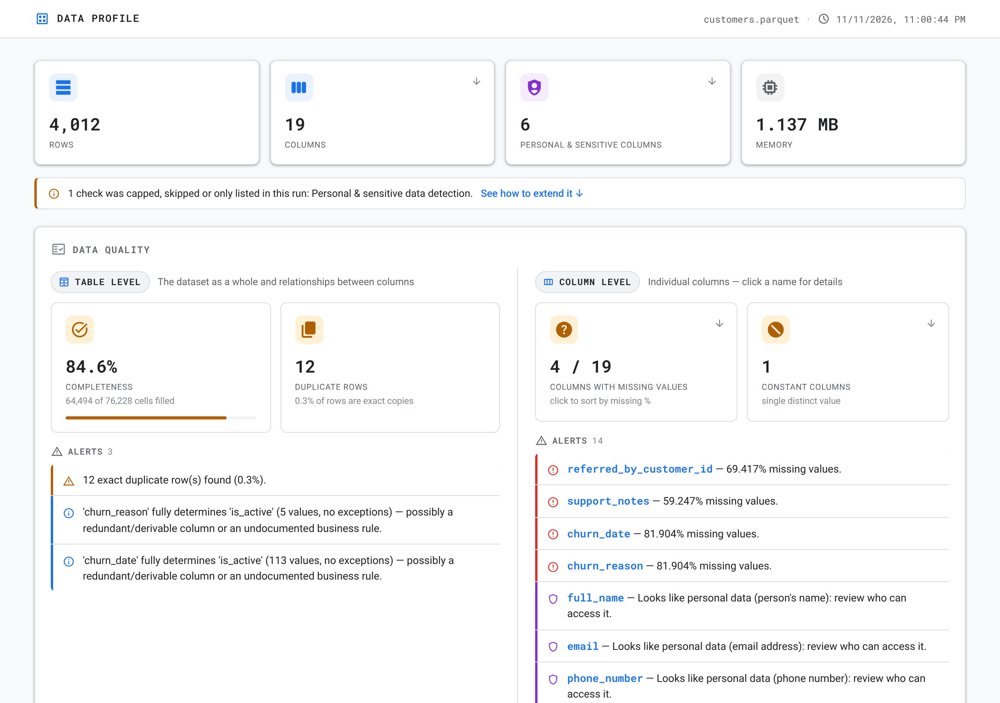
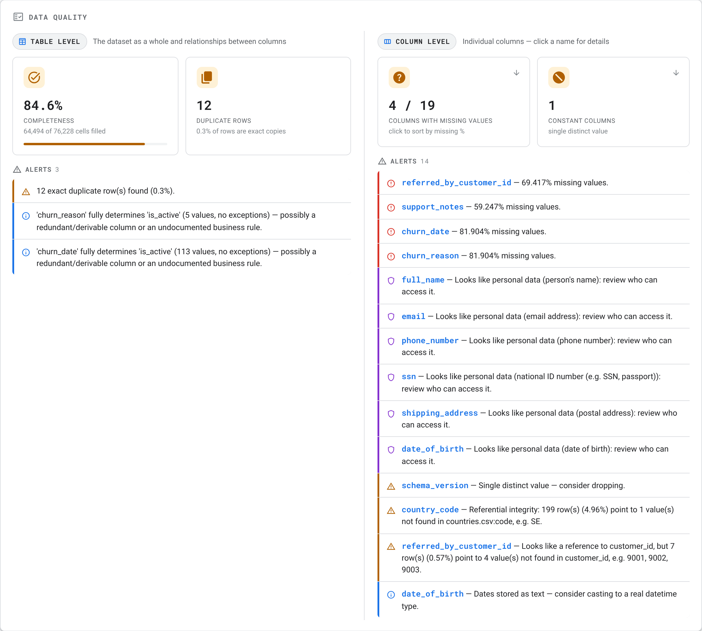
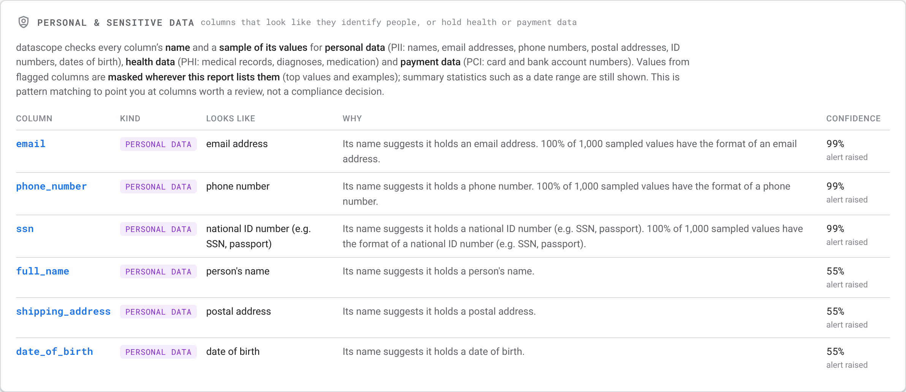
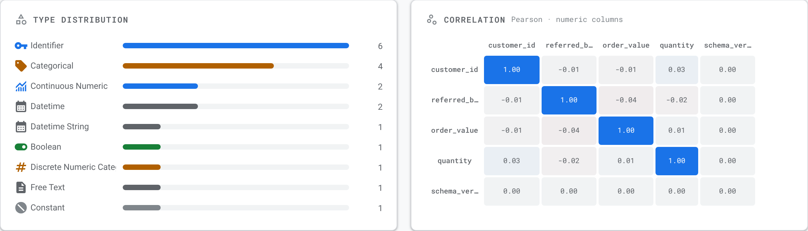
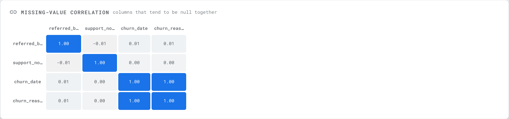
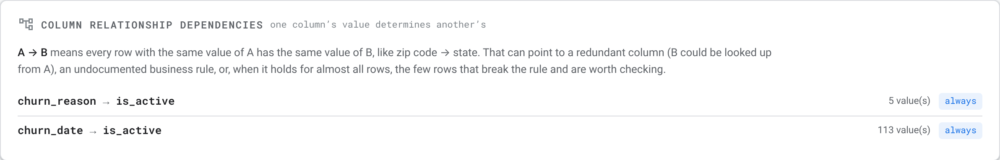
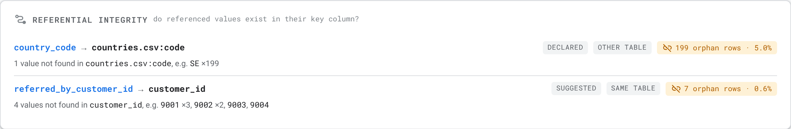
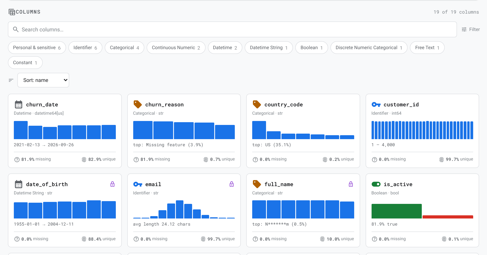
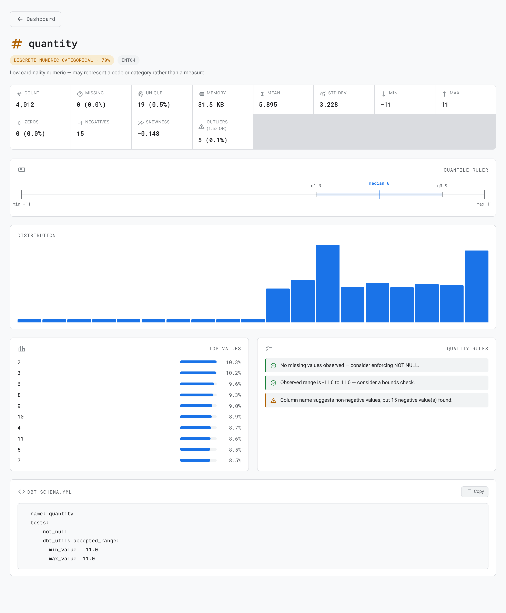
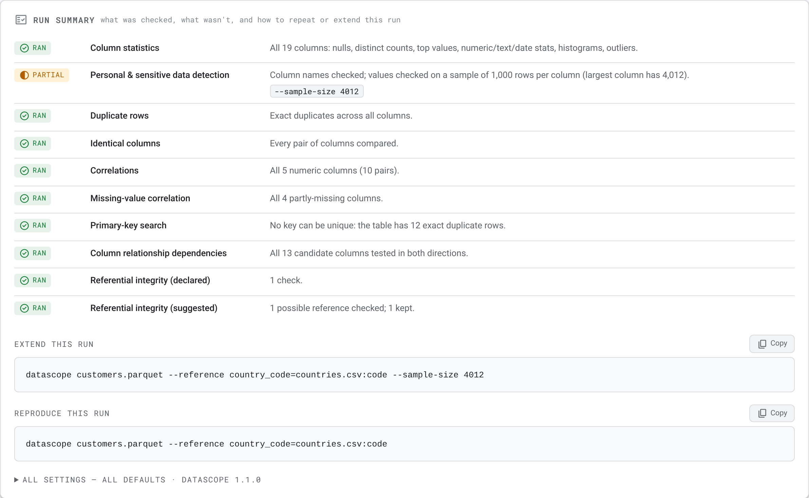

# 🖼️ A tour of the report

> Every panel of a datascope report, what it shows, and how to read it.

[📚 Docs home](README.md) • [🚀 Getting started](getting-started.md) • [🔎 Checks](checks.md) • [☁️ BigQuery](bigquery.md) • [⚙️ Settings](settings.md) • [💻 CLI](cli.md) • [🐍 Python API](python-api.md)

The screenshots come from the [demo dataset](getting-started.md#-try-the-demo-dataset), run as:

```bash
datascope customers.parquet --reference country_code=countries.csv:code
```

---

**On this page**

| Top of the report | Middle | Bottom |
|---|---|---|
| [🧾 Headline tiles](#-headline-tiles) | [📊 Types & correlation](#-types--correlation) | [🧱 The column grid](#-the-column-grid) |
| [🟧 The run strip](#-the-run-strip) | [📭 Missing-value correlation](#-missing-value-correlation) | [🔬 Column detail](#-column-detail) |
| [🩺 Data quality](#-data-quality) | [🔑 Primary-key candidates](#-primary-key-candidates) | [🧮 Run summary](#-run-summary) |
| [🔐 Personal & sensitive data](#-personal--sensitive-data) | [🧩 Column relationship dependencies](#-column-relationship-dependencies) | [💡 Tips](#-tips) |
| | [🔗 Referential integrity](#-referential-integrity) | |

---

## 🧾 Headline tiles



The top row describes the **shape** of the data:

| Tile | Shows | Click it to… |
|---|---|---|
| **Rows** | Number of rows | — |
| **Columns** | Number of columns | ↓ jump to the [column grid](#-the-column-grid), filters cleared |
| **Personal & sensitive columns** | Columns that look like personal, health or payment data | ↓ jump to the [personal & sensitive data](#-personal--sensitive-data) panel |
| **Memory** (pandas) / **Storage** (BigQuery) | Size in memory, or the table's stored size | — |

Tiles with a small **↓** arrow are links. The top bar shows the source name and when the report was generated.

> [!NOTE]
> There's deliberately **no overall quality score**. A single blended number hides which dimension is bad, so each check is reported on its own instead.

---

## 🟧 The run strip

A thin bar under the tiles appears when **this run didn't check everything**: a limit kicked in, a check was turned off, or something was only listed. It names the checks and links to the [run summary](#-run-summary), which has the flags that extend them.

When the report profiles a **sample** of a BigQuery table, the strip says so first, for example *"This report profiles a 1% sample (8,412 rows) of …"*. See [sampling](bigquery.md#-profile-a-sample-first).

---

## 🩺 Data quality



The section is split in two, so it's always clear **what** a finding is about.

<table>
<tr>
<th width="50%">🟦 Table level</th>
<th width="50%">🟪 Column level</th>
</tr>
<tr>
<td valign="top">

The dataset as a whole, and relationships *between* columns.

- **Completeness**: % of all cells that are filled, with the cell counts.
- **Duplicate rows**: exact copies. Shows *Not measured* on BigQuery, rather than a misleading 0.
- **Alerts** not tied to a single column: duplicate rows, identical columns, highly correlated pairs, column relationship dependencies, skipped columns.

</td>
<td valign="top">

Individual columns. **Click a column name** in an alert to open its detail.

- **Columns with missing values**: click to see the grid sorted by missing %.
- **Constant columns**: a single value in every row. Click to filter the grid to them.
- **Alerts** for one column: heavy missingness, personal data, dates stored as text, outliers, infinite values, broken references.

</td>
</tr>
</table>

Alerts are sorted most severe first, and colour-coded:

| Severity | Colour | Examples |
|---|---|---|
| 🔴 **High** | Red | More than half of a column is missing; a declared reference with many orphans |
| 🟣 **Sensitive** | Violet | A column looks like personal data |
| 🟠 **Warning** | Amber | 20–50% missing; constant column; duplicate rows; infinite values |
| 🔵 **Info** | Blue | Correlated pairs; column relationship dependencies; dates stored as text; many outliers |

All these thresholds are settings: see [alert thresholds](settings.md#-all-settings).

---

## 🔐 Personal & sensitive data



Columns that look like they hold:

- 👤 **Personal data (PII)**: names, email addresses, phone numbers, postal addresses, national ID numbers, dates of birth, IP addresses, usernames;
- 🏥 **Health data (PHI)**: medical records, diagnoses, medication, health-insurance IDs;
- 💳 **Payment data (PCI)**: card and bank account numbers.

For each flagged column the panel shows **what it looks like**, **why** it was flagged (in plain words, never quoting values), and the **confidence**, with whether that raised an alert. For example:

> *Its name suggests it holds an email address. 100% of 1,000 sampled values have the format of an email address.*

Values from flagged columns are **masked wherever the report lists them**: top values, example values and so on (`j***@***.com`). Summary statistics, such as a date column's earliest and latest date, are still shown.

> [!IMPORTANT]
> This is pattern matching to point you at columns worth a review, **not** a compliance decision. A column it misses isn't masked. On BigQuery, only column **names** are checked. [How detection works](checks.md#-personal--sensitive-data).

---

## 📊 Types & correlation



- **Type distribution**: how many columns of each [semantic type](checks.md#-semantic-types) (identifier, categorical, continuous numeric, …).
- **Correlation**: the Pearson correlation between numeric columns. **Blue** cells move together, **red** cells move in opposite directions, pale cells are unrelated. Hover over a cell for the exact value. Pairs above the threshold (default |r| ≥ 0.8) also raise an alert.

If the panel is empty it says why: turned off for this run (`--no-correlations`), or fewer than two numeric columns.

---

## 📭 Missing-value correlation



*pandas only.* Which columns tend to be **empty together**. Here `churn_date` and `churn_reason` are always missing in the same rows, a sign of one shared cause upstream: they're only filled in for customers who left.

---

## 🔑 Primary-key candidates

*Appears when there are candidates.* Columns, or combinations of columns, that uniquely identify every row, labelled **Single column** or **Composite**. The demo dataset has none, because its 12 duplicate rows mean no combination can be unique, and the run summary says exactly that. [How the search works](checks.md#-primary-keys).

---

## 🧩 Column relationship dependencies



**A → B** means every row with the same value of A has the same value of B, like *zip code → state*. Each row shows:

- **`A → B`** and how many distinct values of A it's based on;
- **always** (no exceptions), or the share of rows that follow the rule, e.g. **98.5%**. The exceptions are the interesting part: often data-entry mistakes. Hover for the details.

Here, `churn_reason → is_active`: every customer with a churn reason is inactive. That's expected, but it also means `is_active` could be derived rather than stored. [How the search works](checks.md#-column-relationship-dependencies).

---

## 🔗 Referential integrity



Do the values in one column **exist** in a key column? Each check shows:

| Part | Meaning |
|---|---|
| `child → parent` | The column checked, and the key column it should match. Click the child to open its detail |
| **declared** / **suggested** | You asked for it with `--reference`, or datascope spotted it from the column names |
| **same table** / **other table** | Where the key column lives |
| Status pill | ✅ **all matched**, or **N orphan rows · x%** |
| Detail line | How many distinct values are missing, with the most common examples |

In the demo, the country lookup is missing **SE** (199 rows), and 7 customers were *referred by* customer IDs that don't exist. On BigQuery, suggestions are **listed but not checked** by default, with what checking each would cost. [How it works](checks.md#-referential-integrity).

---

## 🧱 The column grid



One card per column, with:

- an **icon and label** for its [semantic type](checks.md#-semantic-types), and its storage type;
- a 🔒 **lock** if it looks like personal data (hover to see what kind);
- a **mini chart**: a histogram, top values, weekday split or true/false split;
- a caption with its range, most common value or average length;
- its **missing %** and **unique %**.

Use the **search box**, the **filter chips** (type, or *Personal & sensitive*) and the **sort menu** (name, missing %, unique %) to find columns. **Click any card** to open its detail.

---

## 🔬 Column detail



Everything about one column:

| Block | What's in it |
|---|---|
| 🏷️ **Badges** | Semantic type with confidence, storage type, and the personal-data category if flagged, with *why* |
| 🔢 **Statistics** | Count, missing, unique, memory; for numbers mean, std dev, min, max, zeros, negatives, skewness, outliers; for text lengths; for dates range and future dates; for booleans true/false |
| 📏 **Quantile ruler** | Min, quartiles, median and max on one line, with the middle 50% shaded |
| 📊 **Distribution** | A larger chart; hover the bars for exact counts |
| 🥇 **Top values** | The most frequent values and their share (masked for personal data) |
| ✅ **Quality rules** | Suggested checks: not null, ranges, accepted values, and warnings such as *negative values in a column whose name implies they can't be negative* |
| 🧪 **dbt schema.yml** | A ready-to-paste dbt test block for the column, with a **Copy** button |

Click **← Dashboard** to go back.

---

## 🧮 Run summary



At the bottom of the report. Every check family, with its status:

| Status | Meaning |
|---|---|
| ✅ **ran** | Done in full |
| ◐ **partial** | A limit kicked in. The flag shown lifts it |
| ○ **skipped** | Turned off for this run. The flag shown turns it back on |
| … **listed** | Found but not run (e.g. suggested references on BigQuery) |
| · **not set up** | Needs input from you, e.g. `--reference` |
| – **not available** | This engine can't do it |
| ✅ **nothing to do** | Nothing to check, e.g. fewer than two numeric columns |

Then two **copyable commands**: one that **extends** the run with every suggested flag, and one that **reproduces** it exactly. Below them, **All settings** expands into every setting used, with changed values highlighted, plus the datascope version. [More on repeatable runs](settings.md).

---

## 💡 Tips

- 🖱️ **Everything with a ↓ or a blue name is clickable**: tiles, alert column names, reference checks.
- 🔎 **Hover** over heatmap cells, chart bars and dependency rows for exact numbers.
- 📤 **Sharing?** The report is one file. Check the [personal data panel](#-personal--sensitive-data) first.
- 🌐 **Offline?** The report works offline, but its fonts and icons come from Google Fonts. Without them, text falls back to your system font and icons show as words.
